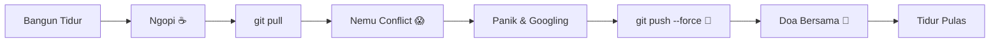

<div align="center">


<a href="https://git.io/typing-svg">
  
</a>

<br/>


<br/><br/>

<a href="https://nnoeel.github.io"></a>
<a href="https://www.instagram.com/nnoelfr/"></a>
<a href="https://www.tiktok.com/@nno3el"></a>
<a href="https://discord.com/users/565118651875983370"></a>

</div>

<br/>

## `whoami`

```yaml
name: Nnoel
role: Programmer & Mahasiswa
location: Indonesia 🇮🇩
building: [NgodingYuk, bot WhatsApp & Discord, website portofolio]
hobbies: [nunggu token reset, mecut AI, nonton windut]
superpower: bisa bikin fitur jalan pas presentasi doang
motto: "Kalau kodenya jalan, JANGAN DISENTUH LAGI!"
```

<br/>

## Proyek Unggulan

<div align="center">
  <a href="https://github.com/NnoeeL/ngodingyuk">
    
  </a>
</div>

| Proyek | Deskripsi | Stack |
| :-- | :-- | :-- |
| **[NgodingYuk](https://github.com/NnoeeL/ngodingyuk)** | Generator PRD dan task berfase untuk AI coding agent | Python, HTML |
| **Bot WhatsApp & Discord** | Otomatisasi grup dan server komunitas, plus dashboard web | Node.js |
| **[Portofolio](https://nnoeel.github.io)** | Rumah semua proyek di atas | HTML, CSS, JS |

<br/>

## Tech Stack

<div align="center">


<br/><br/>

<br/><br/>


</div>

<br/>

## GitHub Stats

<div align="center">
  
  
  <br/>
  
</div>

<br/>

## Daily Algorithm



<br/>

## System Diagnostics

| Resource | Status | Detail |
| :-- | :-- | :-- |
| 🧠 Kapasitas Otak | `42%` | Sisanya kepake mikirin mau makan apa |
| ☕ Kafein | `100%` | Darah 70% kopi, 30% hemoglobin |
| 💤 Jam Tidur | `404 Not Found` | `sleep_schedule.exe` corrupted |
| 🐛 Bug | `It's a feature` | Lolos uji spekulasi pribadi |
| 📦 Dependencies | `node_modules = berat bumi` | `npm audit`: 99 vulnerabilities (diabaikan) |

<br/>

<div align="center">

**Mampir? Kasih bintang di repo ya ⭐**

<sub>Dibuat dengan kopi dan setumpuk error log yang belum di-resolve.</sub>


</div>
