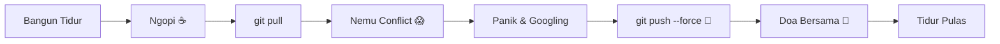

<div align="center">

  <!-- Header Banner -->
  


  <!-- Animated Typing SVG -->
  <a href="https://git.io/typing-svg">
    
  </a>

  <p align="center">
    <a href="#-tentang-saya">Tentang</a> •
    <a href="#-daily-algorithm">Daily Routine</a> •
    <a href="#-arsenal--tech-stack">Tech Stack</a> •
    <a href="#-github-stats">Statistik</a> •
    <a href="#-kontak--sosmed">Kontak</a>
  </p>

  <p align="center">
    
    
    
  </p>

</div>

---

### 🧑‍💻 Tentang Saya

```yaml
name: Nnoel
current_role: "Software Engineer / Professional StackOverflow Googler"
location: "Indonesia 🇮🇩"
hobbies:
  - "Nunggu Token Reset"
  - "Mecut AI"
  - "Nonton windut"
superpower: "Bisa bikin fitur jalan pas presentasi doang"
motto: "Kalau kodenya jalan, JANGAN DISENTUH LAGI!"
```

---

### ⚙️ Daily Algorithm



---

### 📊 System Diagnostics

| Resource | Status | Detail |
| :--- | :--- | :--- |
| 🧠 **Kapasitas Otak** | `42%` | Sisa ram kepake mikirin mau makan apa |
| ☕ **Kafein** | `100%` | Darah saya 70% kopi, 30% hemoglobin |
| 💤 **Jam Tidur** | `404 Not Found` | Error: sleep_schedule.exe corrupted |
| 🐛 **Bug Status** | `It's a feature` | Sudah lolos uji spekulasi pribadi |
| 📦 **Dependencies** | `node_modules = berat bumi` | `npm audit` : 99 vulnerabilities (diabaikan) |

---

### 🛠️ Arsenal & Tech Stack

<div align="center">

#### 💻 Bahasa Pemrograman
<p>
  
  
  
  
  
  
</p>

#### 🚀 Framework & Library
<p>
  
  
  
  
  
  
</p>

#### 🧰 Tools & Database
<p>
  
  
  
  
  
  
  
</p>

</div>

---

### 📈 GitHub Stats

<div align="center">
  
  
</div>

<div align="center">
  <br />
  
</div>

---

### 🤣 Random Dev Joke

<div align="center">
  
</div>

---

### 🐍 Contribution Activity (Snake Eater)

<picture>
  <source media="(prefers-color-scheme: dark)" srcset="https://raw.githubusercontent.com/NnoeeL/NnoeeL/output/github-contribution-grid-snake-dark.svg">
  <source media="(prefers-color-scheme: light)" srcset="https://raw.githubusercontent.com/NnoeeL/NnoeeL/output/github-contribution-grid-snake.svg">
  
</picture>

> *Catatan: Untuk mengaktifkan animasi ular makan commit di atas, cukup pasang GitHub Actions Snake Workflow! (Lihat petunjuk di bawah).*

---

### 📬 Kontak & Sosmed

Yuk ngobrol santai, diskusi project, atau mabar:

<p align="center">
  <a href="https://instagram.com/nnoelfr" target="_blank">
    
  </a>
  <a href="https://www.tiktok.com/@nno3el" target="_blank">
    
  </a>
  <a href="https://discord.com" target="_blank">
    
  </a>
</p>

---

<div align="center">
  <i>⭐️ Kalau mampir jangan lupa kasih bintang di repositori saya ya! ⭐️</i><br/>
  <sub>Dibuat dengan ❤️, ☕, dan setumpuk error log yang belum di-resolve.</sub>
</div>
